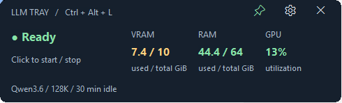
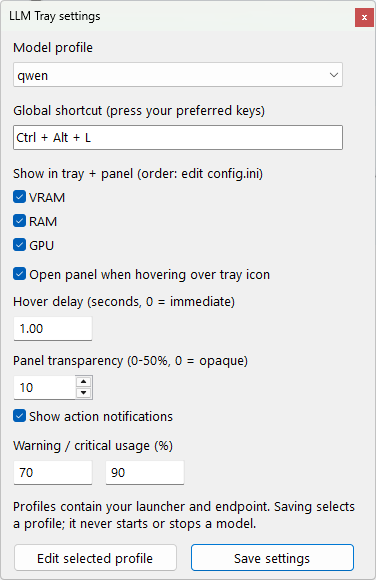

# LLM Tray

A little Windows tray meter for a large local model.

VRAM, RAM and GPU usage live in the notification area. Hover for exact values;
pin and drag the panel when you want it to stay. Toggle your model with a
shortcut, choose your own launcher, and give the GPU back when you are done.

**Windows 11 · AutoHotkey v2 · NVIDIA metrics · MIT · v0.1.3**



The tray icon uses V / R / G meter rows plus a status dot. At the normal16 px
tray size, full numeric labels would be unreadable; hover gives you exact values.
Meters are **whole-device usage**, including your browser and games.

 **Green frame:** model ready.
 **Orange frame:** stopped,
sleeping, loading or unavailable. Hover shows the exact state.

## Install in five minutes

You need Windows PowerShell 5.1 and an existing local inference setup. Model
weights and inference engines are **not** downloaded by this installer.

```powershell
git clone https://github.com/paras-lehana/llm-tray.git E:\llm\llm-tray
cd E:\llm\llm-tray
powershell -NoProfile -ExecutionPolicy Bypass -File .\install.ps1
notepad .\local-data\profiles\llama.ini
Invoke-Item '.\local-data\LLM Tray.lnk'
```

Set your `executable `, ` model_path `, ` model_id`, GPU layers and context size
before clicking Start. The example's20 layers / 8K context are placeholders, not a
fit guarantee. An older llama.cpp may not support native idle sleep; check its
help and startup log. The installer pins AutoHotkey 2.0.30, verifies its archive
and executable, and preserves existing settings. No admin rights, system PATH
change, model download or initial model start. Sign-in startup is opt-in.

**Keep the tray after a restart:** run this once for an existing installation:

```powershell
powershell -NoProfile -ExecutionPolicy Bypass -File .\scripts\startup.ps1 -Action Enable
```

If you installed with a custom `-DataDir`, pass that same directory here. New
installs can use `install.ps1 -StartAtSignIn`. Windows then launches the tray
when you sign in; the model stays under your normal manual/idle controls.
Use `-Action Status` to inspect registration or `-Action Disable` to remove it.
Keep the checkout, runtime and data folder in place. See [startup details](docs/configuration.md#startup-and-removal).

Already have AutoHotkey v2? Copy `examples/config.ini ` and ` examples/profiles/`
into a private data folder, then launch `src/LLMTray.ahk` with that folder as its
first argument. Keep all data/binaries in `local-data/` or outside the checkout.

## Everyday controls

| Action | Result |
|---|---|
| Hover the icon | Show exact VRAM/RAM/GPU values and model state |
| Move away | Hide the panel, unless pinned |
| Pin icon / tray click | Keep the panel visible |
| Drag the header | Move and pin; position survives restart |
| Click model status | Start/wake or stop/unload |
| **Ctrl + Alt + L** | Toggle globally; Windows notification reports the result |
| Right-click → Settings | Choose metrics, profile, shortcut and warning levels |
| Escape / close | Hide and unpin; model keeps its current state |
| Exit tray | Quit the controller; model keeps running |

Windows may put the new icon under **Show hidden icons**. Drag it beside the
clock to keep it visible. This is a notification-area icon, not a taskbar app
button. The pin applies to the detail panel, not Windows' tray visibility.

Drag by holding the panel title. Movement starts on mouse-down; meter updates
pause while you move it and resume on release. Slow status requests run
asynchronously, so they do not hold the panel still. Dragging also pins it.



## Use your own setup

| Profile | What Start does | What Stop does |
|---|---|---|
| **llama.cpp** | Starts your configured executable or wakes a sleeping server | Stops only the exact process this controller started |
| **Ollama** | Preloads your installed model into an already-running Ollama daemon | Unloads that model with `keep_alive: 0`; leaves the daemon alone |
| **Custom scripts** | Runs your trusted `start_script ` | Runs your trusted ` stop_script` |

If a different launcher owns your llama.cpp server, use **Custom scripts**.
The built-in profile deliberately refuses to stop a process it cannot identify.
For example, a guarded launcher can retain its own memory/temperature checks.

- [Configuration guide](docs/configuration.md): INI options, hotkey syntax,
  GPU selection, metric order, extra llama arguments and sample scripts.
- [Remote VS Code](docs/remote-access.md): use your PC model from SSH workspaces
  through loopback tunnels, with no public model listener.
- [Testing and limitations](docs/testing.md): measured checks and unsupported cases.
- [Release task report](docs/tasks/2026-10-17-tray-first/2026-10-17-tray-first-v0.1.0.md).
- [0.1.1 drag fix and measurements](docs/tasks/2026-10-17-smooth-drag/2026-10-17-smooth-drag-v0.1.1.md).
- [0.1.2 remote profile fix and status border](docs/tasks/2026-10-17-remote-profile-border/2026-10-17-remote-profile-border-v0.1.2.md).
- [0.1.3 sign-in startup fix](docs/tasks/2026-10-17-sign-in-startup/2026-10-17-sign-in-startup-v0.1.3.md).

## Sleep, stop and context

With supported llama.cpp, `idle_seconds=1800` adds
`--sleep-idle-seconds 1800`: after30 idle minutes it unloads, and the next request
reloads. Status polling uses passive `/props`. **Manual Stop turns off the
listener**; you must Start before chatting again. Ollama's daemon remains
available after unloading its model.

Sleep unloads live KV as well as model weights. Chat history must be retained
and resent by the client. A larger context limit does not preserve facts across
unloads automatically. The controller does not change reasoning, context,
permissions, model quality or editor prompt latency.

## What is verified

Actual Windows tray hover, hide, pin, drag, settings and shortcut actions were
tested with a Qwen llama.cpp setup. Two remote Linux hosts answered through SSH.
Ollama's request contract is covered by simulated API tests; no real Ollama model
was downloaded for this release. See the report for exact scope and timings.

Current GPU meters use NVIDIA NVML. Without it, GPU/VRAM say **Unavailable**;
RAM and model controls remain usable. AMD/Intel metrics, mixed-DPI monitor
transitions, a signed packaged executable and a clean-machine UI pass are not
certified. Windows Do Not Disturb can suppress visible notifications.

## Contribute or share

Open an issue with Windows version, runtime version, profile with private paths
removed, and a small reproduction. Do not upload credentials, model weights or
raw editor conversations. Run `python -m unittest discover -s tests -v` on Windows.
Python is needed for tests only.

This grew from [Local Coding Lab](https://github.com/paras-lehana/local-coding-lab),
where model quality and instruction-following are evaluated separately. Launch
copy is ready in the [LinkedIn](docs/linkedin.md) and [Medium](docs/medium.md)
**drafts**; neither has been automatically posted.

[License](LICENSE) · [Third-party notices](THIRD_PARTY.md) · [Changelog](CHANGELOG.md)
