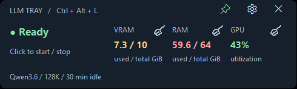

# LLM Tray0.1.6 — resource cleanup brushes

18 October 2026, Asia/Kolkata. Branch:`feat/resource-cleanup-20261018`.
[Owner input](owner-input.md).

## What changed

The installed tray now has a brush beside VRAM, RAM and GPU. Each invokes the
same configured model Stop action. On the owner's custom Qwen profile this
uses the existing ownership-aware stop script. The llama.cpp backend terminates
only its verified owned process; Ollama unloads only the configured model and
leaves its daemon and other models alone. Custom profiles retain their trusted
stop-script contract. Cleanup does not purge Windows caches, guess which apps
are unused, or kill processes by name. The meters continue to show actual whole
device usage, including other apps.

Stop is deliberate rather than Toggle: repeated cleanup must never load a
model. The tooltip explains that cleanup ends the model's active reply. While
an action runs, all brushes disable and the panel shows progress. Completion
shows stopped/unloaded or a failure; readings refresh. The message explains
that llama.cpp must be started before another chat, while Ollama may reload on
its next request. Notifications follow the existing preference. A tray menu
action offers the same cleanup when metric buttons are hidden.

Settings includes **Show LLM cleanup brushes beside metrics**, backed by
`cleanup_buttons=1` by default. Actual Settings save/reload was exercised with
it off and back on: zero and three native controls respectively. The installed
Qwen profile, Ctrl+Alt+L,1000ms hover delay,10% transparency, current position,
pin preference and sign-in shortcut remain in place. Reload did not start or
stop the model.

## UI and accessibility

Each control is a28x24native button with a descriptive name and an original
GDI outline brush. It has native focus and Space activation. The existing
490x148panel size and metric positions are retained. No icon font dependency,
download or new runtime package is introduced. Measured contrast is8.29:1
opaque,6.63:1 with10% transparency over white. Screen-reader use and additional
DPI configurations were not tested.

An actual window render was inspected. It initially caught clipped button text:
AHK normalizes button styles during construction. Applying native BM_SETSTYLE
after all controls exist fixes the brush rendering; the native test now asserts
owner-draw style before and after activation. The final rendered panel shows
three separate brushes with readable labels and no overlap.

This image is the actual installed window rendered with PrintWindow, not a
desktop screenshot. Desktop capture showed the Windows lock screen. An unlock
request was sent; physical hover/click/drag and visible-toast checks are pending.
No keyboard input was sent to an editor and no lock was bypassed. The window
render is opaque; the installed live panel retains its10% transparency.

## Validation and limits

| Check | Result |
|---|---|
|Offline backend/startup/tunnel suite|22tests pass in55.104s, including foreign/stale ownership refusal and two new parser regressions|
|Existing actual AHK status suite|12checks pass; passive status endpoints only|
|New actual native cleanup suite|6checks pass on final source: each brush, repeat/no overlap, Space activation, failed unload/visible error, and hidden controls|
|Settings save/reload|Off →0brushes; on →3brushes; owner preferences preserved|
|PowerShell parse / AHK validate|Pass|
|Public-content audit / documentation links|54files, zero findings;81relative links resolve|
|Native button rendering|Inspected actual rendered window; owner-draw style assertions pass|
|Real Qwen stop/reclaimed RAM and VRAM|Not run: owner's remote conversation is actively generating requests; model left available|
|Physical pointer/drag/visible toast|Not run: desktop capture shows lock screen; no new claim against earlier hover/drag evidence|

The new integration test runs actual AHK controls and the real PowerShell
controller against a disposable Ollama-shaped endpoint. All five observed
POSTs requested only `fixture` with `keep_alive:0`; another listed model remained
untouched. Rapid clicks during cleanup produced one action. A deliberate unload
failure retained the loaded state, showed error text and re-enabled controls.
Space key messages activate the native GPU button. These are directed native
messages, not physical keyboard/mouse interaction or a real Ollama installation.

The first integration run exposed a pre-existing StrictMode bug: an unrelated
Ollama entry with only `name` caused access to its absent `model` property; the
error handler then assumed every exception had an HTTP `Response`. Optional
properties are now checked at both model lookup sites and in the error handler.
Two offline tests cover these cases. No unrelated provider settings changed.

The running production Qwen process was preserved throughout. During this task,
its logs show successive remote requests and active generation. Stopping it for
a memory measurement would repeat the previous remote outage. Real reclaimed
memory is deliberately not claimed from mock tests or old measurements. The
owner's explicit brush click will stop its current reply; normal model starts
remain governed by the existing resource and ownership checks.

## Files and maintained guidance

| File | Change |
|---|---|
|`src/LLMTray.ahk`|Brush drawing/actions, native labels, tooltip, progress/result feedback, busy-state exclusion, Settings toggle|
|`src/Backend.ps1`|Optional Ollama fields and non-HTTP exception handling|
|`tests/check_cleanup.py`|Native UI/controller integration against disposable endpoint|
|`tests/test_backend.py`|Two status/parser regressions|
|`.github/workflows/ci.yml`|Run native cleanup probe after status checks|
|`examples/config.ini`|Default cleanup visibility|
|`README.md`, `CHANGELOG.md`|0.1.6behavior, scope and release entry|
|`docs/configuration.md`, `docs/DESIGN.md`, `docs/testing.md`|Preference, interaction design and exact validation scope|
|`AGENTS.md`|Cleanup safety/regression rules and parser lesson|
|`assets/cleanup-controls.png`, `assets/SHA256SUMS`|Reviewed rendered control image and integrity record|
|`docs/tasks/README.md`, `.github/README.md`|Report and test discovery|
|`docs/tasks.md`, `docs/prompts.md`, this task folder|Request, timeline, report and canonical closeout|

Read project AGENTS/README/DESIGN/tasks and the relevant UI/backend/tests;
shared Codex guide, Claude routing/platform/logging/Git/coding guidance and
Python rules. Applied the next-level-website-designer skill's tool/accessibility
guidance and agent-context-maintenance for project regression rules. Existing
Codex/Claude adapters already route to project rules and remain unchanged.
Native Windows scope supersedes web/mobile/public-URL UI checks. No website
or remote model configuration was changed.

Commands: offline unittest discovery; check_tray_status.py; check_cleanup.py;
PowerShell parser; AHK /validate and argument-preserving reload; private native
Settings/control/render helper; passive model state and existing server-log
inspection. Runtime artifacts and raw captures remain ignored under local-data.
